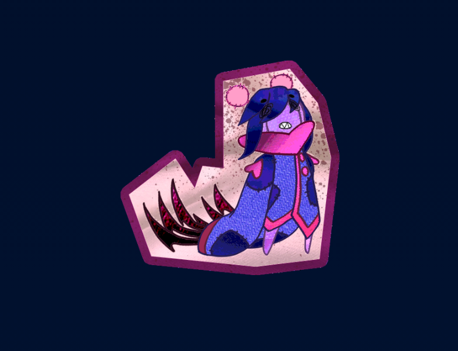
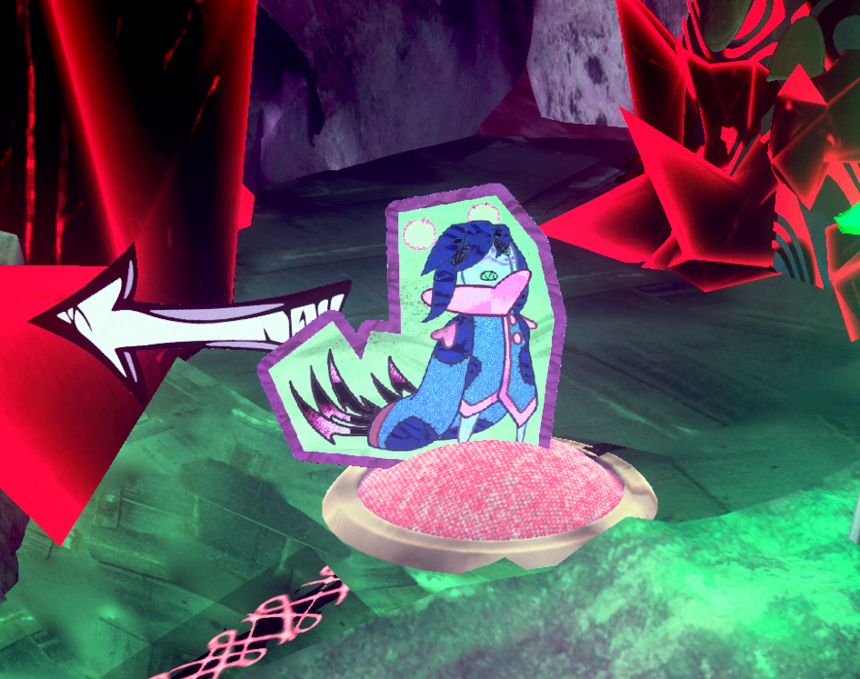
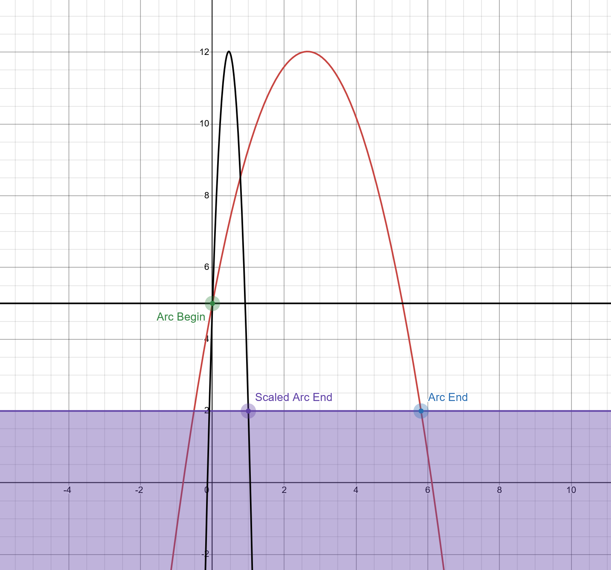
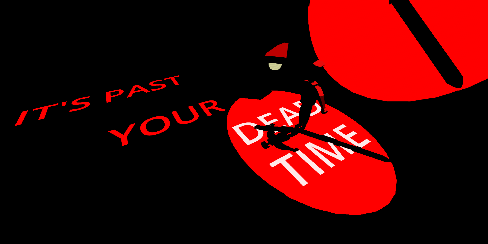

I designed the website for Beat, Heart, Beat: [https://beatheartbeat.com/](https://beatheartbeat.com)<!--more-->

Please give it a look! I have a lot of friends who've spent the past few years working on this game, and I was super enthusiastic about making what essentially was a replacement for their existing linktree. I designed the layout a few months ago, right before the team made the gruelling push to get the game ready for their Early Access. The website went on hiatus[^hiatus] while the BHB team sorted out the game's Early Access launch. It was only a week ago that I offered to finish things up and get the website ready to go live.

[^hiatus]: Funnily enough, I am still in the credits for designing the website even though 

As part of the website launch, the game is on sale now! It's only a few dollars, and it's a lot of fun even if you're just a beginner at rhythm games (like I am!).

The animation that plays when you boot up the website was a lot of fun to make, so I thought I'd share some fun facts about it:

## Peccori looks different from how she does in the game

If you're especially eagle-eyed, you may notice Peccori's texturing is a little off.

Here's how she looks on the website:

And here's how she looks in-game:

The in-game files for Peccori do a little bit of a clever trick to texture her to get that nice "collage" look. Peccori is made of multiple different textures that all have to be composited on top of each other, in a way that makes it feel like she's been cut out of scraps of cloth and paper. So Peccori's main sprite texture has different sections at different percentages of opacity. The sprite renders her coat at 90% opacity, for example. Unity's shader graph then replaces every color of a particular opacity with a specific texture. In effect, each percentage of opacity on the sprite acts as a "mask" for Unity to add the necessary texture.

I only noticed yesterday that this was the case, and spent a few hours on Sunday updating Peccori's look on the website to roughly match the look. For performance reasons, Peccori on the website is stored as a [huge texture](https://beatheartbeat.com/assets/interactive/atlas.png) of all the frames the site needs. Because each sprite frame is 768 x 768 pixels, I just grabbed the textures from the game files, tiled them, and masked them manually in GIMP so that Peccori could keep her iconic collage look! I didn't want to spend the time figuring matching the exact tiling of Peccori's textures[^tiling], so it's not a one-to-one with how she looks in the game.

[^tiling]: In fact, I think the tiling was somehow mirrored in Unity???

## The Quadratic Formula
The Peccori animation was a late addition that I hand-crafted over the course of last weekend. I decided pretty early on that the sprite would *not* scale based on the size of the viewer's screen, but that meant that her position had to change relative to screen size (since a viewer can change their window size at any time).

So, everything about Peccori's animation is mathematically defined. Because she's a platforming character, a lot of that is [linear interpolation](https://en.wikipedia.org/wiki/Linear_interpolation) to determine where she should be. 

That's simple for walking from one corner to another, but her jumps required me to brush up on my (ashamedly, somewhat rusty) pre-calc skills. Peccori's jump arcs can be defined by a simple quadratic arc, and I needed to scale their width so that when `t = 1` (the time when the jump ends), the jump arc is at the destination we want. That involved the use of the quadratic formula:

The hardest part was just figuring out the shape of curve to use. For whatever reason, I first tried to get my existing linear interpolation formula to work, mostly by using a cubic polynomial as the timing function so that Peccori would go "below" her starting point (so it would seem like she was jumping). Eventually I just realized that using a quadratic equation based on the time `t` was the most straightforward, since that's generally used in physics to calculate gravity[^kinematics].

Here's a cleaned up version of the Desmos graph I used to sketch out the idea: [https://www.desmos.com/calculator/qg33i18rak](https://www.desmos.com/calculator/qg33i18rak)

[^kinematics]: See the [kinematics equations](https://en.wikipedia.org/wiki/Equations_of_motion#Constant_linear_acceleration_in_any_direction) for more.

## Conclusion

Thanks to the Beat, Heart, Beat devs who gave feedback on the website! Special thanks to all the folks who worked hard on Peccori's design and characterization throughout the Early Access build, it was a really strong starting point that helped the website come together.

Please buy Beat, Heart, Beat; the folks who make it are really cool and deserve lots of your money.

I've got a 9-to-5, so I don't do as much gamedev stuff as I used to, but I am working on my own game in my spare time:

I've been posting devlog updates on my [Mastodon](https://mathstodon.xyz/@ambiguousname/117181618554368267) and [Bluesky](https://bsky.app/profile/ambiguous.name/post/3mub55iaeyc2m), so follow there for more!